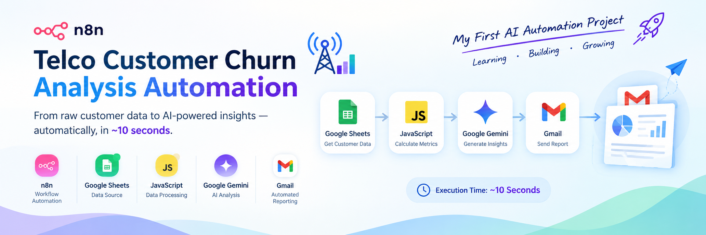

# 🚀 My First AI Automation Workflow — Telco Customer Churn Analysis

  

<h1 align="center">Telco Customer Churn Analysis Automation</h1>

  Automating customer churn analysis with n8n, Google Sheets, JavaScript, Google Gemini AI, and Gmail.

---

Hey everyone! 👋

I'm really excited to share my **first AI automation workflow built using n8n!** 🎉

I'm genuinely glad to be starting my journey into AI automation, and this project is my first step toward exploring how AI, workflow automation, and data analytics can work together to solve real-world business problems.

This is just the beginning! I'm excited to learn, experiment, and gradually build more complex workflows, AI agents, and agentic AI systems using **n8n and other AI automation tools.** 🤖

---

## 📌 About the Project

This project automates the analysis of customer churn data for a telecommunications company (Telco).

The workflow fetches customer data from Google Sheets, calculates important churn metrics using JavaScript, uses Google Gemini AI to generate business insights, formats the findings into a structured report, and automatically sends the final report through Gmail.

The goal is to make customer churn reporting faster, more organized, and easier to understand.

## ⚙️ How the Workflow Works

The workflow consists of the following steps:

1. **Manual Trigger:** Starts the workflow whenever I want to generate a new report.
2. **Google Sheets Integration:** Fetches Telco customer data from Google Sheets.
3. **JavaScript Data Processing:** Calculates customer churn metrics, retention figures, averages, group-wise churn rates, and basic data-quality checks.
4. **AI Agent — Google Gemini:** Analyzes the calculated metrics and generates business insights and actionable customer-retention recommendations.
5. **Automated Email Reporting:** Sends the generated report to Gmail in a structured HTML format.

⏱️ **Execution time:** Approximately 10 seconds in my observed run.

## 🛠️ Tools & Technologies

- **n8n** — Workflow automation and orchestration
- **Google Sheets** — Customer data source
- **JavaScript** — Data processing and churn metric calculations
- **Google Gemini AI** — AI-powered analysis and insight generation
- **AI Agent** — Coordinates the AI analysis step
- **Gmail** — Automated email delivery

## 📂 Repository Contents

Here's what you'll find in this repository:

- 📄 **`workflow/Customer Churn Report.json`** — The exported n8n workflow that you can import and explore.
- 📑 **`reports/churn report mail.pdf`** — The PDF containing the email report output generated by the workflow.
- 🖼️ **`screenshots/`** — Workflow screenshots and execution results, if included.

The JSON file helps you understand how the workflow is structured, while the PDF lets you see the final reporting output without running the workflow yourself.

## 🎯 What I Learned

Building this workflow gave me an opportunity to explore:

- Connecting multiple applications in a single automated workflow.
- Processing customer data using JavaScript.
- Integrating Google Gemini AI with an n8n AI Agent.
- Turning calculated metrics into understandable business insights.
- Automating report generation and email delivery.
- Understanding how different nodes work together to create an end-to-end automation system.

## 🔮 What's Next?

This is only the beginning of my AI automation journey!

I'm looking forward to exploring and building:

- 🤖 More advanced AI agents
- 🔗 Complex, multi-step automation workflows
- 🧠 Agentic AI systems and tool-using agents
- 📊 AI-powered data analysis and reporting
- 🔄 Workflows integrating different AI models, APIs, and business tools
- 🚀 Real-world automation projects that solve practical problems

My goal is to keep learning by building, experimenting, and improving with every project.

## 💬 Final Thoughts

I'm really happy to share my first AI automation project. It may be a small beginning, but every complex system starts with a first step.

I'm excited to see how far this journey takes me, and I look forward to building more powerful workflows and AI agents with n8n and other AI automation tools.

**One workflow at a time, one project at a time! 🚀**

If you have any suggestions, feedback, or recommendations for what I should learn next, I'd love to hear them.

Thanks for checking out my project! ❤️

---

⭐ If you find this project interesting, feel free to star the repository!

#n8n #AIAutomation #ArtificialIntelligence #GoogleGemini #AIAgents #AgenticAI #DataAnalytics #WorkflowAutomation #LearningByBuilding
